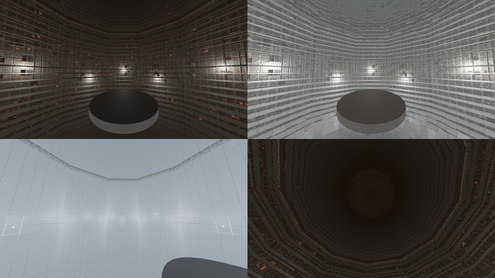

# THE PIT

Experiência PCVR para Meta Quest 3: o participante está numa plataforma suspensa no meio de um poço vertical gigante e aparentemente infinito, com estética industrial de ficção científica de finais dos anos 70. O espaço reconfigura-se e passa por vários estados, do mecânico opressivo ao clínico high-tech.

Escrito em **Rust** com [Bevy](https://bevy.org) 0.19 e [bevy_mod_openxr](https://crates.io/crates/bevy_mod_openxr) 0.6. Não há editor: tudo é código.


## Escala

Blockout sem texturas para sentir a escala no óculos antes de investir em detalhe.

| Elemento | Medida |
|---|---|
| Poço | 12 faces, diâmetro 2 km (alternativas 1 km e 4 km) |
| Ritmo | uma viga anelar a cada 120 m, seja qual for o diâmetro |
| Detalhe | tamanho real fixo: painéis de 10 a 30 m, janelas de ~1 m (textura gerada por código, mosaico de 40 m) |
| Fim do poço | nenhum: 110 módulos para cada lado (~13 km) que se dissolvem no nevoeiro; o vazio tem a cor do nevoeiro |
| Nevoeiro | densidade real em metros (0,00045/m), por isso a parede do outro lado fica apagada como uma montanha distante |
| Plataforma | disco de Ø 4 m a flutuar no centro, sem ponte, corrimão nem outros objetos; chão a y = 0 |
| Referências humanas | passerelles, portas de 2,1 m, escadas e figuras de 1,8 m nas paredes |
| Desempenho | 3 níveis de detalhe por módulo (até 1,3 km, até 3,5 km, resto só casca) |

Porque é que o detalhe não cresce com o poço: se tudo crescer na mesma proporção, um poço de 2 km parece igual a um de 90 m visto de mais longe. Em VR a visão estéreo só dá profundidade até 20 ou 30 m, por isso a escala lê-se pela quantidade de detalhe e pela atmosfera.

## Reconfiguração do espaço

O poço passa sozinho do estado mecânico ao clínico e volta.



- **Mecânico**: as persianas gigantes da parede (painéis de ~60 × 60 m) estão abertas como alhetas horizontais e deixam ver a maquinaria atrás. Luz de sódio, nevoeiro denso.
- **Clínico**: as persianas rodam e fecham numa pele branca e lisa com linhas de luz, a 26 m da parede. Luz fria, nevoeiro mais leve.
- **Sequência**: 60 s parado → 8 s de alarme (as luzes pulsam a vermelho) → 50 s de movimento, com o anel a descer → parado no outro estado.
- **Coreografia**: o fecho é uma onda que vem das duas pontas do poço em direção à plataforma, por isso os últimos painéis a fechar são os que estão à tua altura. A abertura faz o caminho inverso. Os materiais mudam sobretudo quando os painéis perto de ti se mexem.
- Corre em ciclo automático, ou a pedido (A / L). O ciclo automático liga e desliga com Y / P.

## Correr no Quest 3

1. Descarrega `the-pit-windows` (o `.exe`) do último run de **Build Windows** no separador *Actions* do GitHub.
2. Liga o Quest 3 ao PC com **Meta Quest Link** (cabo ou Air Link) e confirma, na app Meta Quest Link do PC, que a Meta está definida como runtime OpenXR ativo (*Settings → General → OpenXR Runtime*).
3. Corre `the_pit.exe`. Ficas no centro da plataforma; o chão real corresponde ao chão da plataforma (espaço *stage*). Se a janela ficar preta, o óculos não foi detetado.

### Comandos

| Ação | Comando Touch | Teclado |
|---|---|---|
| Iniciar a reconfiguração | A | L |
| Mudar diâmetro do poço (1 / 2 / 4 km) | B | 1 / 2 / 3 |
| Anel a descer / parar (teste de enjoo) | X | R |
| Ciclo automático ligado / desligado | Y | P |
| Sair | | Esc |

### Sem óculos

`the_pit.exe --desktop` abre uma janela normal: botão direito do rato para olhar, WASD para andar, Q/E para descer/subir, Shift para ir depressa.

Para gerar uma captura: `the_pit --shot captura.png --view wide|up|down|far|ring|clinical|transition`.

## Compilar

Precisa de Rust estável (no Windows, com as build tools do MSVC).

```
cargo run --release              # VR
cargo run --release -- --desktop # janela
```

## Texturas

As texturas finais vêm do [Fab](https://www.fab.com). Este protótipo ainda não usa nenhuma.
