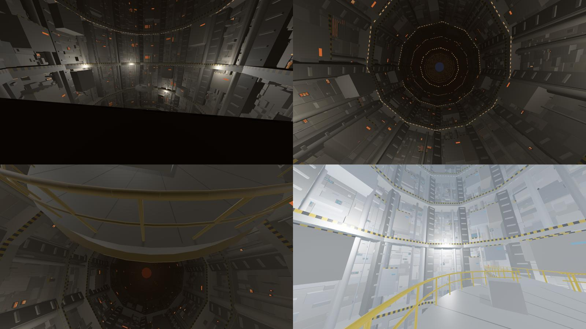

# THE PIT

Experiência PCVR para Meta Quest 3: o participante está numa plataforma suspensa no meio de um poço vertical gigante e aparentemente infinito, com estética industrial de ficção científica de finais dos anos 70. O espaço reconfigura-se e passa por vários estados, do mecânico opressivo ao clínico high-tech.

Escrito em **Rust** com [Bevy](https://bevy.org) 0.19 e [bevy_mod_openxr](https://crates.io/crates/bevy_mod_openxr) 0.6. Não há editor: tudo é código.



## Estado atual: protótipo de escala

Blockout sem texturas para sentir a escala no óculos antes de investir em detalhe.

| Elemento | Medida |
|---|---|
| Poço | 12 faces, diâmetro 400 m (alternativas 200 m e 800 m) |
| Módulo | altura proporcional ao diâmetro (267 m no poço de 400 m), 4 variantes, 14 para cima e 14 para baixo |
| Fim do poço | nenhum: os módulos dissolvem-se no nevoeiro e o vazio tem a cor do nevoeiro |
| Plataforma | disco de Ø 12 m a flutuar no centro, sem ponte, corrimão nem outros objetos; chão a y = 0 |
| Referências humanas | passerelles, portas de 2,1 m, escadas e figuras de 1,8 m nas paredes, sempre à escala real, para parecerem minúsculas |

A estrutura (painéis, vigas, tubagens, máquinas) cresce com o diâmetro; os detalhes humanos não. É essa diferença que dá a escala.

Os estados mecânico e clínico são só parâmetros de material, luz e nevoeiro, por isso a transição demora 4 s e não custa nada em performance.

## Correr no Quest 3

1. Descarrega `the-pit-windows` (o `.exe`) do último run de **Build Windows** no separador *Actions* do GitHub.
2. Liga o Quest 3 ao PC com **Meta Quest Link** (cabo ou Air Link) e confirma, na app Meta Quest Link do PC, que a Meta está definida como runtime OpenXR ativo (*Settings → General → OpenXR Runtime*).
3. Corre `the_pit.exe`. Ficas no centro da plataforma; o chão real corresponde ao chão da plataforma (espaço *stage*). Se a janela ficar preta, o óculos não foi detetado.

### Comandos

| Ação | Comando Touch | Teclado |
|---|---|---|
| Mecânico ↔ clínico | A | L |
| Mudar diâmetro do poço (200 / 400 / 800 m) | B | 1 / 2 / 3 |
| Anel a descer / parar (teste de enjoo) | X | R |
| Sair | | Esc |

### Sem óculos

`the_pit.exe --desktop` abre uma janela normal: botão direito do rato para olhar, WASD para andar, Q/E para descer/subir, Shift para ir depressa.

Para gerar uma captura: `the_pit --shot captura.png --view wide|up|down|far|ring|clinical`.

## Compilar

Precisa de Rust estável (no Windows, com as build tools do MSVC).

```
cargo run --release              # VR
cargo run --release -- --desktop # janela
```

## Texturas

As texturas finais vêm do [Fab](https://www.fab.com). Este protótipo ainda não usa nenhuma.
